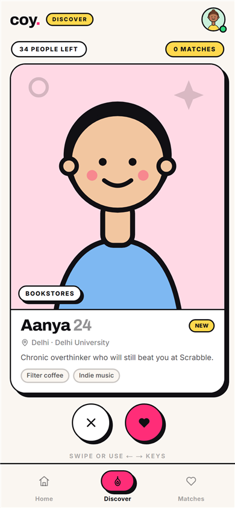
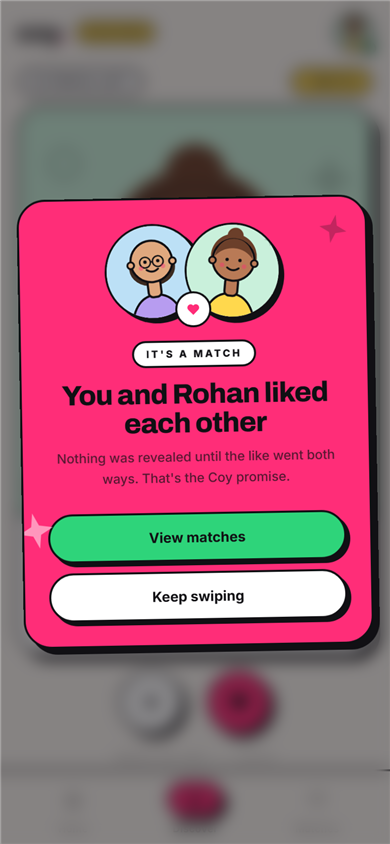
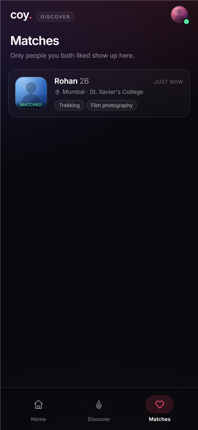

# Coy · Discover

A mobile-first, swipe-based **Discover** tab built for the Coy SDE internship assignment. It is a
standalone Next.js app: a three-tab shell (placeholder **Home**, **Discover**, **Matches**) that
adds a Tinder-style discovery experience without touching Coy's real product.

The core design constraint is Coy's actual promise: **you never learn who liked you until the like
is mutual.** The API enforces that, not just the UI.

| Discover | It's a match | Matches |
| --- | --- | --- |
|  |  |  |

---

## Quick start

Requires Node.js 20.9+ (built and tested on Node 22).

```bash
npm install
npm run dev        # http://localhost:3000
```

Other scripts:

```bash
npm test           # 24 backend + seed tests (node:test)
npm run build      # production build
npm start          # serve the production build
npm run lint       # ESLint
npm run avatars    # regenerate placeholder portraits (optional)
```

The demo database is created automatically on the first request at `data/db.json` and is
gitignored. Use the **Reset demo** button in the empty state (or `POST /api/reset`) to replay the
deck.

---

## What is implemented

| Requirement | How |
| --- | --- |
| 30+ mock profiles | 34 seeded profiles: name, age, photo, bio, city, college, 3 interests |
| Some already liked you | 8 of 34 profiles (`likesYou`, server-side only) |
| One card at a time | Card stack with the next two profiles previewed behind |
| Swipe right / left | Framer Motion drag, velocity + distance thresholds, LIKE / NOPE stamps |
| Buttons on desktop | Explicit pass/like buttons, plus ← / → keyboard shortcuts |
| Smooth animations, clear feedback | Spring-back below threshold, fly-out above it, stamps fade in with drag |
| Never show a swiped profile again | `swipes` persisted server-side; `/api/feed` filters them out |
| Empty state | Dedicated "everyone for now" screen with View matches / Reset demo |
| Mutual-only matches | Match computed only when the user likes someone who already liked them |
| "It's a match!" moment | Full-screen modal with both avatars, opens on the mutual like |
| Matches view | `Matches` tab listing mutual matches, newest first |
| Persistence | JSON store with atomic writes; survives reloads and restarts |
| Backend APIs | `GET /api/feed`, `POST /api/swipe`, `GET /api/matches` (+ demo reset) |

---

## Privacy model

This is the part worth reviewing closely:

- `likesYou` is stored on the server and stripped by `publicProfile()` before any profile leaves
  the API. It is impossible to infer who liked you from the feed payload.
- `GET /api/feed` only returns profiles you have **not** swiped on.
- `POST /api/swipe` returns `matched: true` and the matched profile **only** when the like is
  mutual. A one-sided like returns `{ matched: false, match: null }` — no hint, no count.
- `GET /api/matches` only reads the `matches` collection, which is written exclusively on mutual
  likes. There is no endpoint that enumerates people who liked you.
- Profiles are only swiped once (`409 ALREADY_SWIPED`), matching the "adding is final" spirit of
  the real product and keeping the demo honest.

The matching rules are pure functions in [`lib/matching.mjs`](lib/matching.mjs), so these
properties are covered by tests rather than trust.

---

## API

All responses are JSON and `Cache-Control: no-store`.

### `GET /api/feed`

Returns up to 20 unswiped profiles, in a stable seed order, plus deck stats.

```json
{
  "profiles": [
    {
      "id": "p01",
      "name": "Aanya Malhotra",
      "age": 24,
      "city": "Delhi",
      "college": "Delhi University",
      "bio": "Chronic overthinker who will still beat you at Scrabble.",
      "interests": ["Bookstores", "Filter coffee", "Indie music"],
      "photo": "/avatars/p01.svg"
    }
  ],
  "stats": { "remaining": 34, "likesGiven": 0, "matches": 0 }
}
```

### `POST /api/swipe`

```bash
curl -X POST http://localhost:3000/api/swipe \
  -H "Content-Type: application/json" \
  -d "{\"profileId\":\"p02\",\"action\":\"like\"}"
```

```json
{ "matched": true, "match": { "id": "match_p02", "matchedAt": "…", "profile": { "…": "…" } } }
```

A non-mutual like returns `{ "matched": false, "match": null }`. Passing never matches.

| Status | Code | When |
| --- | --- | --- |
| 400 | `INVALID_JSON` | Body is not valid JSON |
| 400 | `INVALID_BODY` | Body is not an object |
| 400 | `INVALID_PROFILE_ID` | Missing/empty `profileId` |
| 400 | `INVALID_ACTION` | `action` is not `like` or `pass` |
| 404 | `PROFILE_NOT_FOUND` | Unknown profile |
| 409 | `ALREADY_SWIPED` | Profile was already swiped |
| 500 | `INTERNAL` | Unexpected server error |

### `GET /api/matches`

```json
{ "matches": [ { "id": "match_p02", "matchedAt": "…", "profile": { "…": "…" } } ], "count": 1 }
```

Newest first. `profile` uses the same public shape as the feed.

### `POST /api/reset`

Demo-only. Clears swipes and matches and restores the seed. Not something a real product would
expose.

---

## Architecture

```
app/
  layout.js                Fonts, metadata, dark theme
  page.js                  Client tab shell (Home | Discover | Matches)
  api/feed/route.js        GET  unswiped profiles + stats
  api/swipe/route.js       POST record swipe, return match outcome
  api/matches/route.js     GET  mutual matches
  api/reset/route.js       POST reseed (demo helper)
components/
  SwipeCard.jsx            Drag physics, stamps, card face, stack previews
  DiscoverTab.jsx          Feed loading, swipes, empty state, keyboard shortcuts
  MatchModal.jsx           "It's a match!" modal
  MatchesTab.jsx           Mutual match list
  HomeTab.jsx              Placeholder Home tab
  TabBar.jsx, Header.jsx, icons.jsx
lib/
  matching.mjs             Pure feed / swipe / match rules
  validation.mjs           Request validation
  db.mjs                   Atomic JSON store with a single-writer queue
  seed.mjs                 34 profiles + hidden likes
  format.mjs               Relative timestamps
scripts/generate-avatars.mjs
tests/                     23 tests (matching, persistence, validation, seed)
```

### Why a JSON file store?

The brief allows a JSON file, SQLite, or any database. JSON was chosen because it has no native
build step, is readable in review, and is enough for a single-user demo. Writes go through an
in-process queue and an atomic `write → rename`, so concurrent requests cannot lose a swipe.

The trade-off: it is **single-instance only** and relies on a writable filesystem. On a serverless
platform (e.g. Vercel) the filesystem is ephemeral, so a real deployment should swap
`lib/db.mjs` for Postgres/SQLite. The rest of the app is storage-agnostic.

### Visual language

The UI follows Coy's real brand rather than a generic dating-app look: a warm cream canvas,
ink-black 2px outlines with hard offset shadows, hot pink (`#FF2D78`) primary actions, yellow
sticker badges, green for the positive/WhatsApp-style action, and chunky Archivo display type
over Inter body text. Portraits are generated flat illustrations in the same palette, so the
demo needs no external images or licensing.

### Other decisions

- **Tabs are client state, not routes.** The brief asks for a tab bar, and a phone-shell demo does
  not need deep links. It also keeps Discover's deck state alive while switching tabs only when
  needed; each tab currently refetches on mount so the data is always server-truth.
- **SVG placeholder portraits** are generated locally (`npm run avatars`) so the demo works
  offline and no third-party image host or licensing is involved. Replacing a file in
  `public/avatars/` with a real photo is enough to use real images.
- **Framer Motion** handles drag, spring-back, and fly-out. Thresholds: 110px or 700px/s, so a
  quick flick works as well as a long drag.
- **Validation happens at the boundary** (`lib/validation.mjs`) and again in the domain layer
  (`recordSwipe`), so the API cannot record a malformed swipe even if a new route forgets a check.

---

## Tests

`npm test` runs 24 tests with Node's built-in runner — no test framework dependency:

- **Matching rules**: hidden `likesYou`, feed exclusion after a swipe, one-sided like → no match,
  mutual like → match, pass never matches, duplicate swipe → 409, unknown profile → 404, deck
  exhaustion, ordering, public profile shape, gesture → action mapping.
- **Persistence**: seeding on first read, swipes surviving a fresh read from disk, concurrent
  mutations not losing writes, reset restoring the seed.
- **Validation**: malformed bodies, empty ids, invalid actions.
- **Seed integrity**: at least 30 complete profiles, unique ids/orders, at least 5 pre-liked
  profiles, first page limited to 20, every avatar exists on disk.

---

## Known limitations

- Single logged-in user by design (as allowed by the brief); no auth, no rate limiting.
- `POST /api/reset` would be removed or gated behind an internal flag in production.
- The JSON store needs a persistent disk; see the deployment note above.
- No messaging after a match — out of scope for this task.

---
